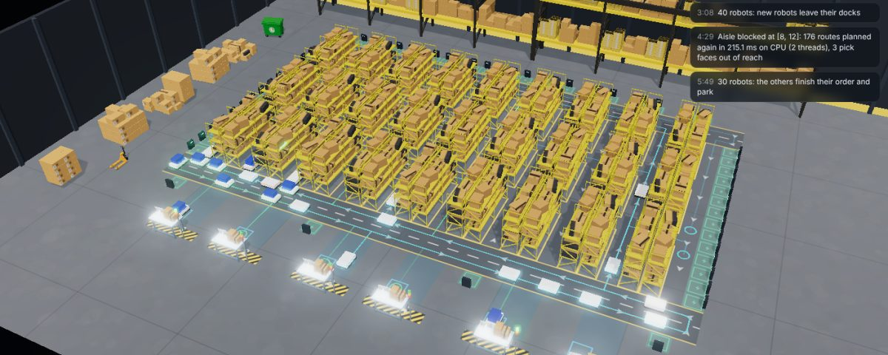

<!-- esasim: cover -->

<!-- /esasim: cover -->

<!-- Banner: upload a picture named banner.png under Data › Readme pictures; it shows here. -->

# Warehouse Fleet

**From one robot to fifty: a goods-to-person warehouse simulated live in 3D, and a fleet-size sweep that finds how many robots it needs, on CPU, NVIDIA GPU or Tenstorrent.**

   

<!-- More badges:  — label, value and colour, written in the address. -->

## Flows

- **1 · Live warehouse**: Fifty robots in a goods-to-person warehouse, live in 3D: change orders, robots and aisles while it runs.
- **2 · How many robots? (fleet-size sweep)**: Hundreds of fleet-size × order-rate scenarios at once: throughput and cost per order against the fleet.
- **3 · Same code, any accelerator (CPU vs GPU vs Tenstorrent)**: The same sweep on the CPU and on the GPU side by side; add a Tenstorrent machine for the third.
- **4 · On Tenstorrent**: The live warehouse and the sweep with Accelerator set to Tenstorrent: routes planned on the Tensix cores with TT-NN. Needs a Linux machine with Tenstorrent cards.
- **5 · Which layout? (same hall, same orders)**: Six layouts of the same building with the same robots, the very same orders and incidents: order time, driving, waiting and storage side by side, with a plan of each.

## What you need

- A computer with the EsaSim worker (Project > Compute); it runs on any worker, faster with: NVIDIA GPU, Tenstorrent.
- Python packages, installed by the worker the first time: `numpy`, `trimesh`, `pycollada`, `pillow`, `scipy`, `torch`.

## How to run it

1. Under **Compute**, check that a worker is available for this project.
2. Press **Run**, choose the worker, and follow the run on the flow's **View** page.
3. The files it made are under **Results**; they stay on the worker until you save or download them.

## What you get

- On the **View** page: *Warehouse in 3D* (4 · On Tenstorrent), *KPIs for the chart* (1 · Live warehouse), *In and out per hour* (1 · Live warehouse), *Run timeline* (1 · Live warehouse), *How many robots?* (2 · How many robots? (fleet-size sweep)), *All results* (2 · How many robots? (fleet-size sweep)), *CPU* (3 · Same code, any accelerator (CPU vs GPU vs Tenstorrent)), *NVIDIA GPU* (3 · Same code, any accelerator (CPU vs GPU vs Tenstorrent)), *How many robots? (Tenstorrent)* (4 · On Tenstorrent), *Order and putaway time by layout* (5 · Which layout? (same hall, same orders)), *Driving by layout* (5 · Which layout? (same hall, same orders)), *Plans: where robots waited (blue little, red a lot)* (5 · Which layout? (same hall, same orders)).

<!-- esasim: files of the project -->

---

An [EsaSim](https://esacode.com/) project of the workspace Gianluca De Novi's workspace (Robotics & manipulation).

### Blueprints in this repository

- [1 · Live warehouse](blueprints/1-live-warehouse.json) · 6 blocks · version 7
- [2 · How many robots? (fleet-size sweep)](blueprints/2-how-many-robots-fleet-size-sweep.json) · 3 blocks · version 2
- [3 · Same code, any accelerator (CPU vs GPU vs Tenstorrent)](blueprints/3-same-code-any-accelerator-cpu-vs-gpu-vs-tenstorrent.json) · 4 blocks · version 2
- [4 · On Tenstorrent](blueprints/4-on-tenstorrent.json) · 5 blocks · version 1
- [5 · Which layout? (same hall, same orders)](blueprints/5-which-layout-same-hall-same-orders.json) · 5 blocks · version 2

### Workspace blocks it uses

- [Warehouse models](blocks/ws-warehouse-models) · version 1
- [Fleet sweep view](blocks/ws-fleet-sweep-view) · version 1

### Assets

The files the project's views draw with (3D models, textures, sounds), in [assets/](assets/):

- [textures/esacode-logo.png](assets/textures/esacode-logo.png) · 25 KB
- [warehouse-kit/sources/aws/LICENSE](assets/warehouse-kit/sources/aws/LICENSE) · 927 B
- [warehouse-kit/sources/mir/LICENSE](assets/warehouse-kit/sources/mir/LICENSE) · 1.5 KB
- [warehouse-kit/sources/mir/mir_100_base.stl](assets/warehouse-kit/sources/mir/mir_100_base.stl) · 1.8 MB
- [warehouse-kit/v6/LICENSES-warehouse-models.txt](assets/warehouse-kit/v6/LICENSES-warehouse-models.txt) · 2.8 KB
- [warehouse-kit/v6/amr.glb](assets/warehouse-kit/v6/amr.glb) · 572 KB
- [warehouse-kit/v6/bin.glb](assets/warehouse-kit/v6/bin.glb) · 209 KB
- [warehouse-kit/v6/desk.glb](assets/warehouse-kit/v6/desk.glb) · 672 KB
- [warehouse-kit/v6/goods_a.glb](assets/warehouse-kit/v6/goods_a.glb) · 768 KB
- [warehouse-kit/v6/goods_c.glb](assets/warehouse-kit/v6/goods_c.glb) · 234 KB
- [warehouse-kit/v6/goods_d.glb](assets/warehouse-kit/v6/goods_d.glb) · 226 KB
- [warehouse-kit/v6/kit.json](assets/warehouse-kit/v6/kit.json) · 1.9 KB
- [warehouse-kit/v6/pallet_jack.glb](assets/warehouse-kit/v6/pallet_jack.glb) · 806 KB
- [warehouse-kit/v6/rack_d.glb](assets/warehouse-kit/v6/rack_d.glb) · 801 KB
- [warehouse-kit/v6/rack_e.glb](assets/warehouse-kit/v6/rack_e.glb) · 439 KB
- [warehouse-kit/v6/rack_f.glb](assets/warehouse-kit/v6/rack_f.glb) · 635 KB

Keys pasted in blocks (secret settings) are not saved here, nor are the team and the results of runs.
